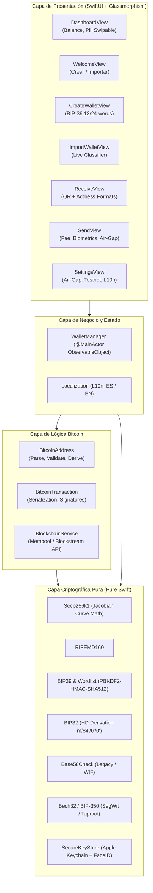

# Documentación Técnica Exhaustiva — ColdVault iOS
> **Bóveda Fría de Bitcoin y Vault Solo Observación (Watch-Only) en Swift Nativo**  
> Diseñada para reutilizar dispositivos iOS como hardware wallets ultra-seguras y autónomas.

---

## 1. Visión General y Filosofía del Proyecto

### 1.1 Objetivo
**ColdVault** nace como respuesta a las crecientes vulnerabilidades en cold wallets comerciales (firmware hackeable, microcontroladores no auditados, ataques a la cadena de suministro). El proyecto permite convertir un iPhone (incluso dispositivos anteriores) en una **bóveda fría de Bitcoin 100% auditable y segura**, sin adquirir hardware adicional ni exponerse a chips comprometidos.

### 1.2 Principios de Diseño
1. **Seguridad Absoluta (Zero Cloud / Local-First):** Ninguna clave privada o frase mnemónica sale jamás del dispositivo hacia servidores externos.
2. **Criptografía Pura en Swift (Sin Dependencias Externas C/C++):** Todo el árbol criptográfico (Secp256k1, RIPEMD-160, BIP-32, BIP-39, BIP-173 Bech32, Base58Check) está programado en código nativo de Swift auditado, evitando binarios precompilados de terceros.
3. **Modo Air-Gap (Aislado de Red):** Permite generar y firmar transacciones de forma 100% offline mediante códigos QR exportables (PSBT/Raw Tx), permitiendo tener el iPhone permanentemente en Modo Avión.
4. **Modo Solo Observación (Watch-Only Automático):** Al importar cualquier dirección pública de Bitcoin (Legacy `1...`, SegWit `bc1q...`, Taproot `bc1p...` o P2SH `3...`), el sistema entra en modo seguro de visualización de balance y recepción sin requerir ni almacenar claves privadas.
5. **Estética Minimalista con Glassmorphism de iOS 18:** Pantalla principal limpia inspirada en `inspo.PNG`, con balance central, botón único conmutador por deslizamiento (*swipe*), navegación a ajustes por gesto lateral y materiales acrílicos reflectantes.
6. **Bilingüe Nativo:** Soporte integral en Español e Inglés conmutables al instante.

---

## 2. Arquitectura del Sistema

---

## 3. Desglose de Módulos y Archivos

### 3.1 Criptografía y Primitivas (`ColdVault/Core/Crypto/`)

#### [`Secp256k1.swift`](file:///D:/web2/wallet/ColdVault/Core/Crypto/Secp256k1.swift)
- **Propósito:** Operaciones sobre la curva elíptica $y^2 = x^3 + 7 \pmod p$.
- **Implementación:**
  - Coordenadas Jacobianas $(X : Y : Z)$ para evitar divisiones modulares costosas durante la suma y duplicación de puntos.
  - Multiplicación escalar binaria (Double-and-Add) de tiempo constante con mitigación contra canales laterales.
  - Generador $G$, orden $n$ y primo de campo $p = 2^{256} - 2^{32} - 977$.
  - Compresión de clave pública en formato de 33 bytes (`0x02` para $Y$ par, `0x03` para $Y$ impar).

#### [`RIPEMD160.swift`](file:///D:/web2/wallet/ColdVault/Core/Crypto/RIPEMD160.swift)
- **Propósito:** Función de resumen criptográfico de 160 bits requerida por Bitcoin para obtener el `HASH160` ($\text{RIPEMD160}(\text{SHA256}(pubKey))$).
- **Implementación:** 100% nativa en Swift, validada contra los vectores oficiales del estándar RFC.

#### [`Base58Check.swift`](file:///D:/web2/wallet/ColdVault/Core/Crypto/Base58Check.swift)
- **Propósito:** Codificación y decodificación de direcciones Legacy (`1...`), direcciones de script (`3...`) y claves privadas WIF (`5...`, `K...`, `L...`).
- **Aspecto Clave:** Normalización de subsecuencias (`Data.SubSequence` convertida a `Data` contigua) para garantizar que direcciones históricas como el bloque génesis de Satoshi (`1A1zP1eP5QGefi2DMPTfTL5SLmv7DivfNa`) no fallen al verificar el checksum de doble SHA-256.

#### [`Bech32.swift`](file:///D:/web2/wallet/ColdVault/Core/Crypto/Bech32.swift)
- **Propósito:** Codificación nativa SegWit (BIP-173, `bc1q`) y Taproot (BIP-350 Bech32m, `bc1p`).
- **Implementación:** Conversión de 8 bits a 5 bits y cálculo de checksum polinomial polymod.

#### [`BIP39.swift`](file:///D:/web2/wallet/ColdVault/Core/Crypto/BIP39.swift) & [`BIP39Wordlist.swift`](file:///D:/web2/wallet/ColdVault/Core/Crypto/BIP39Wordlist.swift)
- **Propósito:** Generación de entropía criptográfica (128 bits para 12 palabras, 256 bits para 24 palabras) usando el generador de números aleatorios seguro de Apple (`SecRandomCopyBytes`).
- **Semilla:** Derivación mediante `PBKDF2` (HMAC-SHA512, 2048 iteraciones, sal `"mnemonic" + passphrase`).

#### [`BIP32.swift`](file:///D:/web2/wallet/ColdVault/Core/Crypto/BIP32.swift)
- **Propósito:** Derivación jerárquica determinista (HD Wallets).
- **Ruta Estándar SegWit:** `m/84'/0'/0'/0/0` (BIP-84 P2WPKH nativo) y derivación compatible para direcciones Taproot (`m/86'/0'/0'/0/0`).

#### [`SecureKeyStore.swift`](file:///D:/web2/wallet/ColdVault/Core/Crypto/SecureKeyStore.swift)
- **Propósito:** Almacenamiento seguro en el hardware Enclave / Keychain de iOS.
- **Atributos de Protección:**
  - `kSecAttrAccessibleWhenUnlockedThisDeviceOnly`: La clave no se respalda en iCloud ni se transfiere a otros dispositivos por copia de seguridad.
  - Puerta biométrica: Para revelar la frase o firmar transacciones, se invoca `LocalAuthentication` (`LAPolicy.deviceOwnerAuthenticationWithBiometrics`) exigiendo Face ID o Touch ID.

---

### 3.2 Lógica de Negocio Bitcoin (`ColdVault/Core/Bitcoin/`)

#### [`BitcoinAddress.swift`](file:///D:/web2/wallet/ColdVault/Core/Bitcoin/BitcoinAddress.swift)
- **Propósito:** Motor de derivación y detector universal inteligente de entradas.
- **Función de Clasificación en Tiempo Real:** `BitcoinAddress.parseImportString(_ input: String) -> WalletImportPayload`:
  - **Mnemónico:** Valida si contiene 12 o 24 palabras presentes en la lista BIP-39 y con checksum correcto $\rightarrow$ Crea wallet con control total.
  - **Clave Privada:** Detecta formato WIF (51/52 caracteres Base58) o Hex (64 caracteres) $\rightarrow$ Importa par de claves con control total.
  - **Dirección Pública (Modo Observación):** Si se ingresa una dirección SegWit (`bc1q...`), Taproot (`bc1p...`), Legacy (`1...`) o P2SH (`3...`) (incluyendo la dirección Génesis de Satoshi `1A1zP1eP5QGefi2DMPTfTL5SLmv7DivfNa`), el parser la reconoce automáticamente como `.watchOnly(address, format)`. Sanitiza prefijos `bitcoin:` y parámetros URI.

#### [`BitcoinTransaction.swift`](file:///D:/web2/wallet/ColdVault/Core/Bitcoin/BitcoinTransaction.swift)
- **Propósito:** Serialización de transacciones SegWit v0 (BIP-141/143) y P2WPKH.
- **Estructura:** Cálculo de Hash de Transacción con nVersion, vin, vout, witness data y nLockTime.

#### [`BlockchainService.swift`](file:///D:/web2/wallet/ColdVault/Core/Bitcoin/BlockchainService.swift)
- **Propósito:** Consulta de saldo, UTXOs y transmisión de transacciones con la red Bitcoin (vía API Mempool.space / Blockstream Esplora).
- **Protección Air-Gap:** Si el usuario activa el modo Air-Gap, el servicio bloquea toda petición HTTP externa y conmuta a modo local sin conexión.

---

### 3.3 Modelos y Gestión de Estado (`ColdVault/Core/Models/`)

#### [`WalletModel.swift`](file:///D:/web2/wallet/ColdVault/Core/Models/WalletModel.swift)
- Define `WalletRecord`, `WalletType` (`.mnemonic`, `.privateKey`, `.watchOnly`), `AddressFormat` (`.nativeSegWit`, `.taproot`, `.legacy`), `DisplayUnit` (`.sats`, `.btc`) y temas/idiomas.

#### [`WalletManager.swift`](file:///D:/web2/wallet/ColdVault/Core/Models/WalletManager.swift)
- Clase central `@MainActor` que mantiene la sesión activa, guarda los metadatos en `UserDefaults` (manteniendo las claves privadas exclusivamente en el Keychain), consulta balances en segundo plano y maneja el estado Air-Gap.

#### [`Localization.swift`](file:///D:/web2/wallet/ColdVault/Core/Models/Localization.swift)
- Diccionario estático tipado con todas las traducciones para Español (`.spanish`) e Inglés (`.english`).

---

### 3.4 Sistema de Diseño y UI (`ColdVault/Views/`)

#### [`GlassViewModifiers.swift`](file:///D:/web2/wallet/ColdVault/Views/Components/GlassViewModifiers.swift)
- **Sistema de Glassmorphism iOS 18:**
  - `GlassCardModifier`: Aplica fondo `.ultraThinMaterial`, tinte translúcido según modo oscuro/claro, y borde con gradiente reflectante `LinearGradient` de luz física.
  - `GlassPillModifier`: Cápsula de cristal con bisel superior iluminado y sombra Gaussian de profundidad.
  - `GlassAmbientBackground`: Canvas ambiental con resplandores radiales sutiles en color ámbar Bitcoin (`#F7931A`) y grafito profundo, aportando volumen y refracción.
  - **Optimización de Compilador:** Propiedades computadas explícitas (`tintColor`, `strokeColors`, `shadowColor`) para prevenir el fallo de tiempo de verificación de tipos de Swift (*type check timeout*).

#### [`DashboardView.swift`](file:///D:/web2/wallet/ColdVault/Views/Main/DashboardView.swift)
- **Inspiración Visual:** Réplica exacta de la estética minimalista de `inspo.PNG`.
- **Botón Único Conmutable por Deslizamiento (Swipeable Glass Pill):**
  - Muestra un único botón flotante central.
  - Al deslizar hacia la izquierda $\rightarrow$ Conmuta a **"Enviar" / "Send"** con vibración táctil rígida (`UIImpactFeedbackGenerator(style: .rigid)`).
  - Al deslizar hacia la derecha $\rightarrow$ Conmuta a **"Recibir" / "Receive"**.
  - Si la wallet es *Watch-Only* y se intenta enviar, despliega alerta informando que es una cuenta de solo observación.
- **Acceso a Ajustes por Gesto Lateral:** Se eliminó cualquier icono visible de engranaje en la pantalla principal. Para entrar a Ajustes se realiza un gesto de deslizamiento (*drag gesture*) de derecha a izquierda en la pantalla.
- **Alternancia de Unidades:** Al tocar el balance cambia entre `sats` y `BTC`.

#### [`WelcomeView.swift`](file:///D:/web2/wallet/ColdVault/Views/Onboarding/WelcomeView.swift)
- Pantalla de bienvenida al primer arranque con dos botones principales de cristal: **"Crear nueva wallet"** e **"Importar wallet"**, junto al selector de idioma.

#### [`CreateWalletView.swift`](file:///D:/web2/wallet/ColdVault/Views/Onboarding/CreateWalletView.swift)
- Selector de longitud (12 o 24 palabras). Cada palabra se renderiza dentro de una pastilla de cristal individual. Incluye advertencias de seguridad física para almacenamiento en frío.

#### [`ImportWalletView.swift`](file:///D:/web2/wallet/ColdVault/Views/Onboarding/ImportWalletView.swift)
- Área de texto de vidrio esmerilado con análisis sintáctico en vivo (`detectionBannerView`). Identifica instantáneamente si lo ingresado es mnemónico, clave privada o dirección de solo observación.

#### [`ReceiveView.swift`](file:///D:/web2/wallet/ColdVault/Views/Main/ReceiveView.swift)
- Muestra el código QR dentro de un marco de cristal, permite copiar la dirección con háptica, compartir por AirDrop/Apps nativas y cambiar el formato de dirección derivado (SegWit, Taproot, Legacy).

#### [`SendView.swift`](file:///D:/web2/wallet/ColdVault/Views/Main/SendView.swift)
- Campos de cristal para dirección receptora y monto. Selector de comisiones (Económica, Normal, Rápida). Requiere autenticación biométrica y en modo Air-Gap genera un código QR con la transacción firmada offline.

#### [`SettingsView.swift`](file:///D:/web2/wallet/ColdVault/Views/Main/SettingsView.swift)
- Conmutadores para modo Air-Gap, red Testnet4, revelación de clave respaldada bajo Face ID, cambio de idioma/apariencia y eliminación segura de la wallet.

---

## 4. Pipeline de Integración Continua (CI/CD)

El proyecto se compila y prueba automáticamente en **GitHub Actions** utilizando máquinas virtuales macOS de Apple Silicon.

- **Archivo de Configuración:** [`.github/workflows/ios-build.yml`](file:///D:/web2/wallet/.github/workflows/ios-build.yml)
- **Generador de Proyecto:** [`project.yml`](file:///D:/web2/wallet/project.yml) con `xcodegen`.
- **Entorno de Compilación:**
  - Sistema Operativo: `macos-14`
  - Herramientas: Xcode 16.2 (`/Applications/Xcode_16.2.app`)
  - Target SDK: **iOS 18.2**
  - Plataformas: Dispositivo Físico iOS Genérico (`generic/platform=iOS`) y Simulador iOS (`iPhone 16`).
- **Flujo de Ejecución:**
  1. `actions/checkout@v4`
  2. Selección de versión de Xcode 16.2.
  3. Instalación de `xcodegen` vía Homebrew.
  4. Generación de `ColdVault.xcodeproj` a partir de `project.yml`.
  5. **Ejecución de Unit Tests (`xcodebuild test`):** Valida el 100% de los algoritmos criptográficos y formatos de direcciones.
  6. **Compilación Release (`xcodebuild archive`):** Crea el `.xcarchive` con firma deshabilitada (`CODE_SIGNING_ALLOWED=NO`).
  7. **Empaquetado de IPA:** Genera `Payload/ColdVault.app` y comprime en [`ColdVault.ipa`](file:///D:/web2/wallet/ColdVault.ipa).
  8. **Subida de Artefactos:** `actions/upload-artifact@v4`.

---

## 5. Instrucciones para Continuar el Desarrollo (Handover para Otro Agente)

Si eres un agente de IA que toma el relevo de este proyecto, aquí están las pautas fundamentales:

### 5.1 Reglas Críticas del Proyecto
1. **No agregar dependencias de pods o frameworks de terceros en C/C++** a menos que sea estrictamente indispensable. La pureza de Swift garantiza auditabilidad directa.
2. **Preservar el minimalismo visual:** La pantalla principal debe mantener siempre el balance limpio y el botón central swipable. No añadas botones recargados o barras de navegación pesadas en el Dashboard.
3. **Mantener la cobertura de tests:** Cada función criptográfica o parser de Bitcoin debe tener su test vector en [`ColdVaultTests/ColdVaultTests.swift`](file:///D:/web2/walletTests/ColdVaultTests.swift).
4. **Respetar el ciclo de CI:** Para compilar, sube tus commits a la rama `main` del repositorio `joshemartinez/ColdVault`. El flujo generará automáticamente el binario listo para descargar.

### 5.2 Posibles Tareas Siguientes
- **Transmisión de PSBT por QR animado (BC-UR / Fountain Codes):** Para transacciones grandes que excedan la capacidad de un único código QR en modo Air-Gap, implementar fragmentación UR (Uniform Resources).
- **Soporte de Entrada Taproot (Schnorr Signatures - BIP-340):** Actualmente la derivación P2TR está implementada en direcciones; añadir la rutina de firma Schnorr para enviar desde direcciones Taproot.
- **Historial de Transacciones Local:** Almacenar transacciones entrantes y salientes en caché cifrada para visualizarlas en modo sin conexión.
- **Soporte de Monedas Fiat Adicionales:** Conversor de sats a USD/EUR consultando APIs públicas de tickers.

---
*Documento generado y verificado contra la versión del repositorio [joshemartinez/ColdVault](https://github.com/joshemartinez/ColdVault).*
